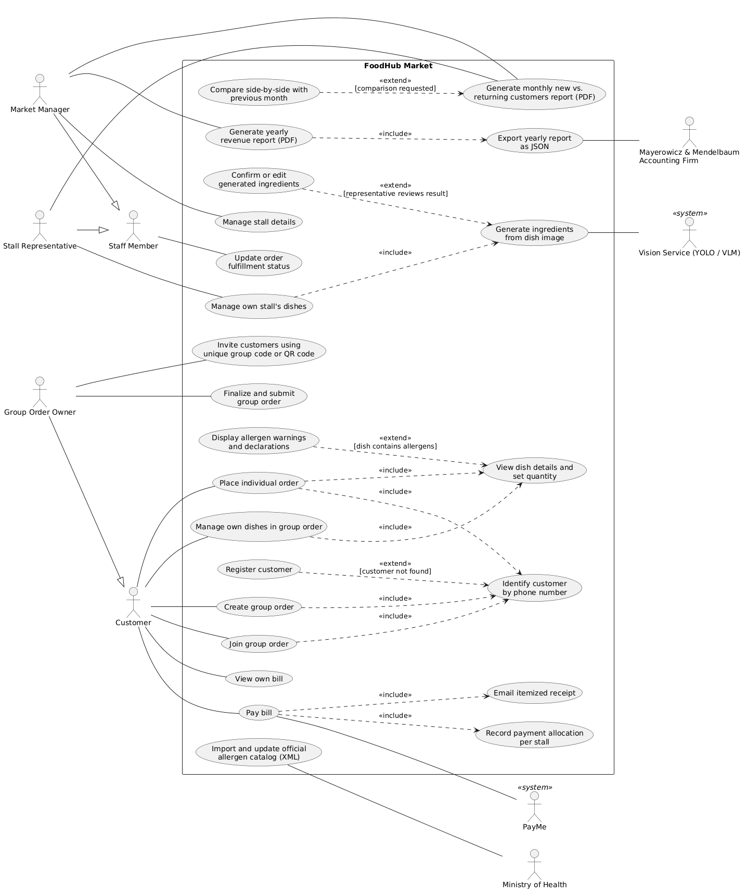
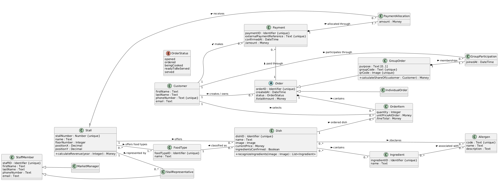

# FoodHub Market: Information System Design 🍜

Analysis and design of an information system for **FoodHub Market**, a food market with multiple stalls where customers can place individual or group orders, pay through an external payment service, and see allergen information for every dish.

> Course project: Design and Implementation of Information Systems, B.Sc. Information Systems, University of Haifa.

## 📌 What the system does

- **Customers** are identified by phone number, place **individual orders** or create and join **group orders** (with a unique group code or QR code), view their bill and pay
- **Payments** go through the external PayMe service; each payment is split between the stalls involved, and an itemized receipt is sent by email
- **Stall representatives** manage their stall's dishes; ingredients can be generated automatically **from a dish image** using a vision service (YOLO / VLM) and then confirmed or edited
- **Allergens** are linked to ingredients, and the official allergen catalog is imported from the Ministry of Health (XML)
- **Staff** update order fulfillment status: opened → ordered → being cooked → ready to be served → served
- **Market manager** manages stalls and generates reports: yearly revenue (PDF, exported as JSON to the accounting firm) and monthly new vs. returning customers

## 📐 UML diagrams

### Use Case Diagram

### Class Diagram

Design highlights:
- Abstract `Order` with `IndividualOrder` and `GroupOrder` subclasses
- `StaffMember` generalization into `MarketManager` and `StallRepresentative`
- Association classes such as `OrderItem`, `GroupParticipation` and `PaymentAllocation`
- Derived attributes (`/totalAmount`, `/lineTotal`, `/amount`) and an `OrderStatus` enumeration

## 🗄 Database (MS Access)

The design is implemented as a relational database in [`database/FoodHub.accdb`](database/FoodHub.accdb), with primary and foreign keys, relationships, and sample data.

**Tables:** Customers, Stalls, StallFoodTypes, FoodTypes, Dishes, Ingredients, DishIngredients, Allergens, AllergenIngredients, Orders, OrderLines, OrderStatuses, OrderStatusHistory, GroupOrders, GroupParticipants, Payments, PaymentAllocations, StaffMembers, Roles

**Queries:**
- `qryStallYearRevenue`: yearly revenue per stall
- `qryMarketYearRevenue`: total yearly revenue of the market

> All data in the database is fictional sample data.

## 🛠 Tools

UML (Use Case, Class Diagram) · PlantUML · MS Access · SQL
